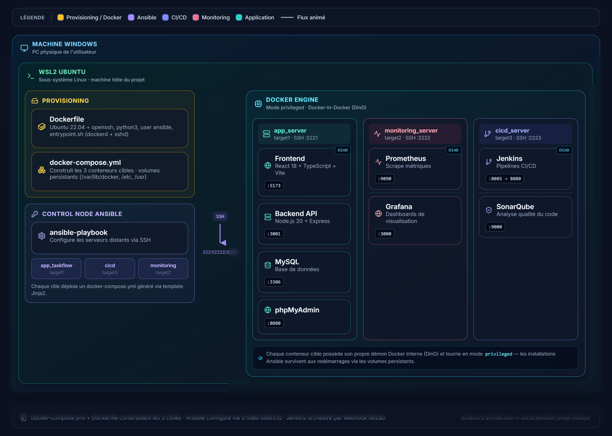

# Projet DevOps — Infrastructure automatisée avec Ansible, Docker, Jenkins et monitoring

> Projet de mise en place d'une infrastructure DevOps reproductible : provisionnement des environnements, configuration automatisée des serveurs, déploiement conteneurisé d'une application, intégration continue et supervision.

## Sommaire

- [1. Présentation du projet](#1-présentation-du-projet)
- [2. Objectifs](#2-objectifs)
- [3. Architecture générale](#3-architecture-générale)
- [4. Rôle des composants](#4-rôle-des-composants)
- [5. Flux de fonctionnement](#5-flux-de-fonctionnement)
- [6. Technologies utilisées](#6-technologies-utilisées)
- [7. Organisation Ansible](#7-organisation-ansible)
- [8. Ports des services](#8-ports-des-services)
- [9. Persistance et redémarrage](#9-persistance-et-redémarrage)
- [10. Démarrage et vérification](#10-démarrage-et-vérification)
- [11. Améliorations envisagées](#11-améliorations-envisagées)

## 1. Présentation du projet

L'objectif de ce projet est de construire un petit environnement DevOps local, piloté depuis **Windows avec WSL2 Ubuntu**, afin de mettre en pratique l'automatisation d'infrastructure et le déploiement d'applications.

Le projet sépare les responsabilités en trois serveurs cibles :

1. **Serveur applicatif (`app_server`)** : héberge le frontend, l'API backend, la base de données MySQL et phpMyAdmin.
2. **Serveur CI/CD (`cicd_server`)** : héberge Jenkins pour l'orchestration des pipelines et SonarQube pour l'analyse statique de la qualité du code.
3. **Serveur de monitoring (`monitoring_server`)** : héberge Prometheus pour la collecte des métriques et Grafana pour leur visualisation.

Les environnements cibles sont construits à partir d'un `Dockerfile` et d'un fichier `docker-compose.yml`. **Ansible** configure ensuite les serveurs à distance via SSH, au moyen de rôles distincts et de templates Jinja2. Chaque serveur cible utilise Docker pour exécuter ses services dans des conteneurs.

Cette architecture est conçue comme un **laboratoire pédagogique** : elle permet de reproduire les principaux mécanismes d'une chaîne DevOps sans nécessiter immédiatement trois machines physiques ou trois serveurs cloud.

## 2. Objectifs

- Automatiser la préparation des serveurs au lieu de les configurer manuellement.
- Organiser l'infrastructure sous forme de code (*Infrastructure as Code*).
- Utiliser Ansible, son inventaire, ses playbooks, ses rôles, ses variables et ses templates Jinja2.
- Conteneuriser les composants avec Docker et Docker Compose.
- Séparer les environnements applicatif, CI/CD et monitoring.
- Préparer l'intégration d'un pipeline Jenkins déclenché par les changements du dépôt Git.
- Contrôler la qualité du code avec SonarQube.
- Collecter et visualiser les métriques avec Prometheus et Grafana.
- Conserver les données importantes au moyen de volumes persistants.

## 3. Architecture générale



*Figure : architecture logique du laboratoire DevOps. Les conteneurs cibles sont lancés dans l'environnement Docker représenté dans le schéma.*

### Vue d'ensemble

```text
Machine Windows
└── WSL2 Ubuntu
    ├── Provisionnement
    │   ├── Dockerfile
    │   └── docker-compose.yml
    ├── Nœud de contrôle Ansible
    │   ├── Inventaire des serveurs
    │   ├── Playbooks
    │   └── Rôles : app_taskflow, cicd, monitoring
    └── Docker Engine / environnement Docker-in-Docker
        ├── app_server
        │   ├── Frontend React + TypeScript + Vite
        │   ├── Backend Node.js + Express
        │   ├── MySQL
        │   └── phpMyAdmin
        ├── monitoring_server
        │   ├── Prometheus
        │   └── Grafana
        └── cicd_server
            ├── Jenkins
            └── SonarQube
```

> **Note d'architecture :** le schéma représente une configuration de laboratoire utilisant des conteneurs cibles avec Docker-in-Docker (DinD) en mode privilégié. Ce mode est pratique pour apprendre, mais il accorde des privilèges élevés aux conteneurs. Pour une utilisation en production, privilégier des hôtes/VM dédiés, une isolation renforcée et une gestion stricte des accès.

## 4. Rôle des composants

### 4.1. Provisionnement Docker

Le `Dockerfile` prépare l'image de base des serveurs cibles, notamment avec Ubuntu, OpenSSH, Python 3 et l'utilisateur utilisé par Ansible. Le script d'entrée peut démarrer le service SSH et le démon Docker interne lorsque le scénario DinD est utilisé.

Le fichier `docker-compose.yml` construit et lance les trois serveurs cibles, configure leurs noms et leurs ports SSH, et définit les volumes nécessaires à la persistance.

### 4.2. Nœud de contrôle Ansible

Ansible est exécuté depuis WSL2 Ubuntu. Il se connecte aux serveurs cibles via SSH et applique la configuration souhaitée.

- **Inventaire** : répertorie les serveurs et leurs paramètres de connexion.
- **Playbooks** : définissent les opérations à appliquer et les hôtes concernés.
- **Rôles** : organisent les tâches par responsabilité (`app_taskflow`, `cicd`, `monitoring`).
- **Variables** : centralisent les ports, chemins et paramètres configurables.
- **Templates Jinja2** : génèrent les fichiers Compose selon les variables définies.
- **Idempotence** : les tâches sont conçues pour pouvoir être rejouées sans provoquer de changements inutiles lorsque l'état attendu est déjà atteint.

### 4.3. Serveur applicatif — `app_server`

| Composant | Fonction |
|---|---|
| Frontend React, TypeScript et Vite | Interface utilisateur accessible depuis un navigateur |
| Backend Node.js et Express | API qui traite les requêtes de l'application |
| MySQL | Stockage des données applicatives |
| phpMyAdmin | Interface web d'administration de MySQL |

Le frontend communique avec l'API backend, qui accède à la base de données. phpMyAdmin est un outil d'administration ; il ne remplace pas la sécurisation de MySQL ni les sauvegardes.

### 4.4. Serveur CI/CD — `cicd_server`

| Composant | Fonction |
|---|---|
| Jenkins | Automatise les étapes d'intégration et de livraison via des pipelines |
| SonarQube | Analyse le code source et fournit des indicateurs de qualité et des alertes |

La cible est de relier le dépôt Git à Jenkins afin qu'un push ou un webhook puisse lancer un pipeline. Selon la configuration mise en place, ce pipeline peut exécuter les tests, lancer l'analyse SonarQube, construire les images Docker et préparer ou effectuer le déploiement.

**État fonctionnel à documenter honnêtement :** la présence des conteneurs Jenkins et SonarQube ne signifie pas, à elle seule, que le pipeline complet et l'analyse qualité sont déjà configurés. Décrire ces étapes comme « en cours » ou « prévues » tant qu'elles n'ont pas été testées de bout en bout.

### 4.5. Serveur de monitoring — `monitoring_server`

| Composant | Fonction |
|---|---|
| Prometheus | Collecte et stocke des métriques exposées par des cibles configurées |
| Grafana | Présente les métriques dans des tableaux de bord |

Pour obtenir une supervision effective, il faut configurer les cibles Prometheus et exposer les métriques appropriées. La simple exécution de Prometheus et Grafana ne garantit pas que les conteneurs, l'hôte ou l'application soient déjà supervisés.

## 5. Flux de fonctionnement

1. Les images des serveurs cibles sont construites à partir du `Dockerfile`.
2. Docker Compose démarre les trois serveurs et leurs ports SSH.
3. Ansible lit l'inventaire et se connecte à chaque serveur via SSH.
4. Les playbooks appliquent les rôles correspondant à chaque groupe de serveurs.
5. Chaque rôle prépare les répertoires nécessaires et génère le fichier Compose à partir d'un template Jinja2.
6. Les services applicatifs, CI/CD et monitoring sont démarrés avec Docker Compose sur leurs serveurs respectifs.
7. À terme, Jenkins automatise les contrôles et le déploiement à partir du dépôt Git ; SonarQube analyse le code et Prometheus/Grafana permettent d'observer les métriques configurées.

## 6. Technologies utilisées

- **Système et environnement :** Windows, WSL2, Ubuntu, SSH.
- **Conteneurisation :** Docker, Docker Compose, Docker-in-Docker pour le laboratoire.
- **Automatisation :** Ansible, playbooks YAML, rôles, variables, templates Jinja2.
- **Application :** React, TypeScript, Vite, Node.js, Express.
- **Données :** MySQL, phpMyAdmin.
- **CI/CD et qualité :** Jenkins, SonarQube.
- **Observabilité :** Prometheus, Grafana.
- **Gestion de code :** Git et dépôt distant.

## 7. Organisation Ansible

Exemple d'organisation possible du répertoire Ansible :

```text
ansible/
├── ansible.cfg
├── inventory.ini
├── group_vars/
│   └── all.yml
├── playbooks/
│   └── site.yml
└── roles/
    ├── common/
    │   └── tasks/
    │       └── main.yml
    ├── app_taskflow/
    │   ├── defaults/
    │   │   └── main.yml
    │   ├── tasks/
    │   │   └── main.yml
    │   └── templates/
    │       └── docker-compose.yml.j2
    ├── cicd/
    │   ├── defaults/
    │   │   └── main.yml
    │   ├── tasks/
    │   │   └── main.yml
    │   └── templates/
    │       └── docker-compose.yml.j2
    └── monitoring/
        ├── defaults/
        │   └── main.yml
        ├── tasks/
        │   └── main.yml
        └── templates/
            └── docker-compose.yml.j2
```

L'organisation réelle peut différer. Le principe important est de garder les tâches réutilisables dans les rôles et d'éviter de dupliquer la configuration entre les serveurs.

## 8. Ports des services

Ports présentés dans le schéma :

| Service | Port du conteneur / service | Exposition indiquée |
|---|---:|---|
| Frontend | 5173 | `app_server` |
| Backend API | 3001 | `app_server` |
| MySQL | 3306 | `app_server` |
| phpMyAdmin | 8080 | `app_server` |
| Prometheus | 9090 | `monitoring_server` |
| Grafana | 3000 | `monitoring_server` |
| Jenkins | 8080 | `cicd_server`, publié sur `8085 → 8080` |
| Jenkins agent | 50000 | `cicd_server` si nécessaire |
| SonarQube | 9000 | `cicd_server` |
| SSH des serveurs cibles | 2221 / 2222 / 2223 côté hôte | vers le port SSH 22 des conteneurs respectifs |

Ces ports sont ceux prévus/illustrés par le schéma. Vérifier les mappings réels dans le fichier Compose et les règles réseau avant de considérer les services accessibles. Éviter d'exposer directement MySQL, phpMyAdmin, Jenkins ou SonarQube sur Internet sans contrôle d'accès, pare-feu et HTTPS.

## 9. Persistance et redémarrage

Les volumes persistants permettent de conserver les données lorsque les conteneurs sont recréés. Le schéma mentionne notamment des répertoires persistants pour l'environnement cible, tels que `/var/lib/docker`, `/etc` et `/usr`.

Pour les services, vérifier spécifiquement les volumes associés à :
- MySQL : fichiers de données de la base ;
- Jenkins : configuration, jobs et plugins ;
- SonarQube : données, extensions et journaux ;
- Prometheus : base de séries temporelles, si une conservation est souhaitée ;
- Grafana : configuration et tableaux de bord, si stockés localement.

Les volumes exacts dépendent des fichiers Compose du dépôt. Les données persistantes ne remplacent pas une stratégie de sauvegarde.

## 10. Démarrage et vérification

Les commandes ci-dessous sont des exemples à adapter aux chemins et noms réellement présents dans le dépôt.

### Construire et lancer l'infrastructure

```bash
docker compose up -d --build
docker compose ps
```

### Vérifier la connectivité Ansible

Depuis le répertoire Ansible :

```bash
ansible all -m ping
```

Le module `ping` d'Ansible vérifie que l'agent peut se connecter au serveur et exécuter Python ; il ne s'agit pas d'un simple ping ICMP.

### Appliquer les playbooks

```bash
ansible-playbook playbooks/site.yml
```

### Vérifier les services sur le serveur concerné

```bash
docker ps
docker compose ps
docker logs --tail 100 <nom_du_conteneur>
```

Si un service redémarre en boucle, consulter d'abord ses journaux et vérifier les ressources, les volumes, les permissions et les prérequis de l'image. SonarQube peut notamment nécessiter des paramètres noyau et des ressources mémoire adaptés ; en environnement de production, il faut également utiliser une base de données supportée plutôt que le stockage embarqué de démonstration.

## 11. Améliorations envisagées

- Finaliser un pipeline Jenkins déclenché par webhook Git.
- Ajouter les tests automatisés et une étape de contrôle qualité SonarQube (*quality gate*).
- Automatiser la construction, l'étiquetage et le déploiement des images Docker.
- Configurer Prometheus pour collecter les métriques des hôtes et des conteneurs, puis créer des tableaux de bord Grafana.
- Ajouter des alertes et des notifications.
- Sécuriser les secrets avec des variables protégées ou Ansible Vault.
- Utiliser HTTPS, des règles réseau minimales et une authentification forte.
- Ajouter une stratégie de sauvegarde et de restauration des volumes.
- Pour une évolution vers un environnement plus réaliste, remplacer le DinD privilégié par des machines virtuelles ou des hôtes dédiés, et séparer les environnements de développement et de production.

---

## Résumé

Ce projet met en pratique une chaîne DevOps locale basée sur **Docker pour la conteneurisation**, **Ansible pour l'automatisation de l'infrastructure**, **Jenkins pour l'intégration et la livraison continues**, **SonarQube pour la qualité du code**, et **Prometheus/Grafana pour la supervision**. Il vise à rendre l'environnement reproductible, organisé et évolutif, tout en séparant les responsabilités entre application, CI/CD et monitoring.
